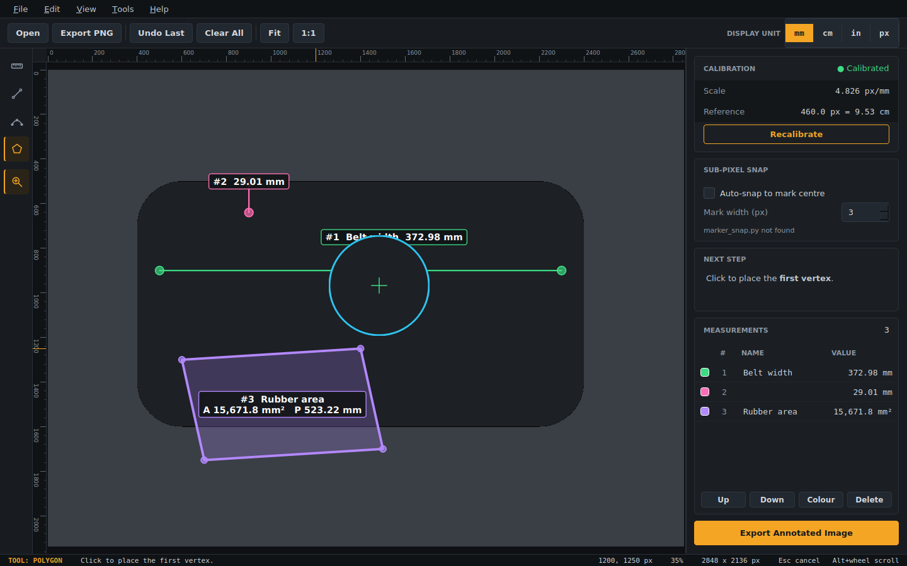

# Tire Measure Tool

A desktop tool for taking **real-world measurements from photos**: calibrate against a ruler in the image, then measure straight lines, curved contours and labelled polygon areas. Built with PyQt5 for tire cross-section and footprint analysis, but it works on any photo that contains a reference scale.


<!-- Replace with a screenshot of the tool on a real photo. -->

## Features

- **Calibration** from any two marks of known distance (mm, cm, in, m) gives a px/mm scale
- **Line tool**: straight two-point distance
- **Bead contour tool**: multi-point polyline for curved edges, reports total arc length
- **Polygon tool** (labelme-style): the cursor snaps to the first vertex to close the shape; reports area and perimeter, and asks for a label name
- **Labels**: drag to move, double-click to rename, change colour (presets, colour wheel, hex), reorder and renumber from the list
- **Accurate placement**: zoom at cursor, magnifier loupe, rulers that follow zoom/pan, optional sub-pixel snapping to graduation marks
- **Units**: switch between mm / cm / in / px at any time, and every value updates
- **Export** the annotated image at full original resolution (PNG or JPG)
- Dark, instrument-style UI with menu bar, toolbar, tool rail and a scrollable side panel

## Install

Requires Python 3.9+.

```bash
git clone https://github.com/<your-username>/tire-measure-tool.git
cd tire-measure-tool
python -m venv .venv
# Windows: .venv\Scripts\activate      macOS/Linux: source .venv/bin/activate
pip install -r requirements.txt
```

## Run

```bash
python measure_tool.py                  # opens a file picker
python measure_tool.py path/to/photo.jpg
```

## Quick start

1. Open a photo that has a ruler or other known distance in it.
2. **Calibrate**: click two graduation marks, then enter the real distance and unit.
3. Pick a tool in the left rail and measure. Values appear on the image and in the **Measurements** list.
4. Fine-tune labels (move, rename, recolour, reorder), then **Export Annotated Image**.

See [docs/USAGE.md](docs/USAGE.md) for the full guide.

## How calibration works

The tool measures in original image pixels, so zoom never affects accuracy.

```
px_per_mm = pixel_span / (real_distance * unit_to_mm)
```

Lengths are stored in pixels and converted for display, so recalibrating updates every measurement. Polygon area uses the shoelace formula divided by `px_per_mm ** 2`.

## Optional: sub-pixel snapping

If `marker_snap.py` is in the same folder, clicks on calibration, line and bead points can snap to the weighted centre of a dark graduation mark. This corrects the 1-3 px error from clicking an anti-aliased edge. It needs `numpy` and `opencv-python-headless`. Without the file the tool runs normally and the option is greyed out. Polygon vertices are never snapped.

## Project structure

```
tire-measure-tool/
├── measure_tool.py     # the application
├── marker_snap.py      # optional sub-pixel snapping module
├── requirements.txt
├── docs/
│   ├── USAGE.md
│   └── screenshots/
├── CHANGELOG.md
├── LICENSE
└── README.md
```

## Not implemented yet

- Saving and loading a session (measurements and calibration) as JSON
- CSV export of the measurement table

## License

MIT. See [LICENSE](LICENSE).
